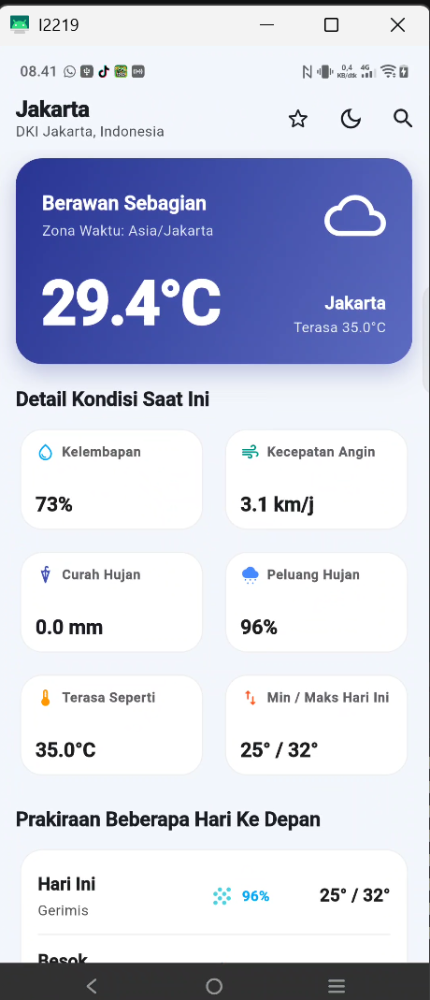
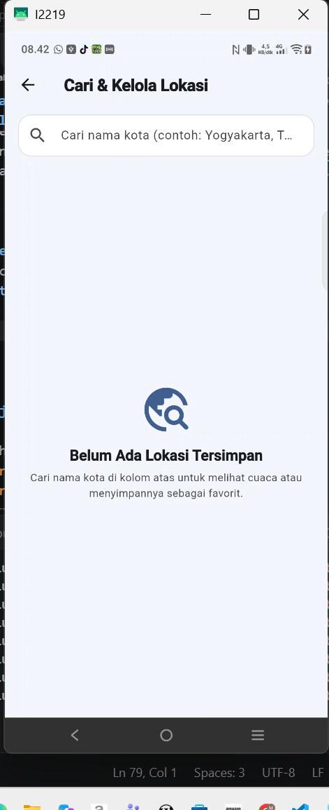

# CuacaKu — Aplikasi Cuaca Flutter (Responsi Pemrograman Mobile)

Aplikasi informasi cuaca berbasis **Flutter** dan **Dart** yang menggunakan **Open-Meteo REST API** serta menerapkan pola arsitektur **Model-View-ViewModel (MVVM)** dengan manajemen state **Provider** dan penyimpanan lokal **SharedPreferences**.

## Fitur Utama

1. **Home / Weather Screen** (`lib/views/home_screen.dart`)
   - Menampilkan nama kota yang sedang dipilih beserta wilayah/negara.
   - Menampilkan kondisi cuaca terkini (ikon & deskripsi berdasarkan `weather_code`), suhu saat ini (`current.temperature_2m`), dan suhu yang dirasakan (`current.apparent_temperature`).
   - Menampilkan detail tambahan: kelembapan udara (`current.relative_humidity_2m`), kecepatan angin (`current.wind_speed_10m`), curah hujan (`current.precipitation`), peluang hujan (`daily.precipitation_probability_max`), serta suhu minimum dan maksimum harian (`daily.temperature_2m_min` & `daily.temperature_2m_max`).
   - Menampilkan prakiraan cuaca 7 hari ke depan secara responsif.
   - Mendukung *pull-to-refresh*, *Light/Dark Mode*, bar akses cepat kota favorit, serta penanganan state *loading*, *empty*, dan *error*.

2. **Search / Location Screen** (`lib/views/search_screen.dart`)
   - Pencarian kota secara *real-time* menggunakan Open-Meteo Geocoding API (HTTP `GET`).
   - Memilih lokasi dari hasil pencarian untuk langsung memperbarui cuaca pada Home Screen.
   - Menyimpan dan menghapus lokasi favorit serta riwayat pencarian secara persisten menggunakan **SharedPreferences**.

---

## Struktur Aplikasi (MVVM)

```text
lib/
├── main.dart                         # Entry point & MultiProvider setup
├── models/                           # MODEL: Representasi data JSON & entitas domain
│   ├── location_model.dart           # Model lokasi (Geocoding & Local Storage)
│   └── weather_model.dart            # Model CurrentWeather, DailyForecast, WeatherResponse
├── services/                         # DATA / SERVICE LAYER: HTTP GET & Local Storage
│   ├── weather_api_service.dart      # Client HTTP GET ke Open-Meteo Forecast & Geocoding API
│   └── local_storage_service.dart    # Persistensi favorit, riwayat, dan lokasi terakhir
├── viewmodels/                       # VIEWMODEL: State management (ChangeNotifier)
│   ├── weather_viewmodel.dart        # State cuaca, lokasi terpilih, favorit, dan tema
│   └── search_viewmodel.dart         # State pencarian kota dan riwayat pencarian
├── views/                            # VIEW: Halaman antarmuka pengguna
│   ├── home_screen.dart              # Home / Weather Screen (StatelessWidget)
│   └── search_screen.dart            # Search / Location Screen (StatefulWidget)
├── widgets/                          # Komponen UI reusable & responsif
│   ├── weather_detail_grid.dart      # Grid metrik cuaca adaptif
│   └── daily_forecast_list.dart      # Daftar prakiraan cuaca harian
├── theme/
│   └── app_theme.dart                # Konfigurasi Material Design 3 Theme & Typography
└── utils/
    └── weather_code_helper.dart      # Pemetaan WMO weather_code ke label, ikon, dan gradien
```

---

## Penerapan Arsitektur MVVM

- **Model** (`lib/models/`): Mendefinisikan struktur data `LocationModel`, `CurrentWeather`, `DailyForecast`, dan `WeatherResponse` lengkap dengan `fromJson` / `toJson` untuk konversi JSON dari API dan Local Storage.
- **View** (`lib/views/` & `lib/widgets/`): Terdiri dari `HomeScreen` (`StatelessWidget`) dan `SearchScreen` (`StatefulWidget`). View hanya bertugas merender UI berdasarkan state dari ViewModel dan meneruskan aksi pengguna ke ViewModel tanpa logika bisnis/networking langsung.
- **ViewModel** (`lib/viewmodels/`): `WeatherViewModel` dan `SearchViewModel` mewarisi `ChangeNotifier` (via `provider`). ViewModel memanggil `WeatherApiService` dan `LocalStorageService`, mengelola state (`loading`, `loaded`, `empty`, `error`), lalu memanggil `notifyListeners()` agar UI otomatis diperbarui.

---

## Implementasi Open-Meteo API

Semua permintaan jaringan dilakukan dengan metode **HTTP GET** menggunakan package `http` pada `lib/services/weather_api_service.dart`:

1. **Weather Forecast API**
   - Endpoint: `https://api.open-meteo.com/v1/forecast`
   - Parameter:
     - `latitude`, `longitude`: Koordinat lokasi terpilih
     - `current`: `temperature_2m,relative_humidity_2m,apparent_temperature,precipitation,weather_code,wind_speed_10m`
     - `daily`: `weather_code,temperature_2m_max,temperature_2m_min,precipitation_probability_max`
     - `timezone`: `auto`

2. **Geocoding API**
   - Endpoint: `https://geocoding-api.open-meteo.com/v1/search`
   - Parameter: `name`, `count=10`, `language=id`, `format=json`

---

## Screenshot Aplikasi
Home Screen


Search Screen


---

## Menjalankan & Menguji Aplikasi

```bash
flutter pub get
flutter analyze
flutter test
flutter run
```
